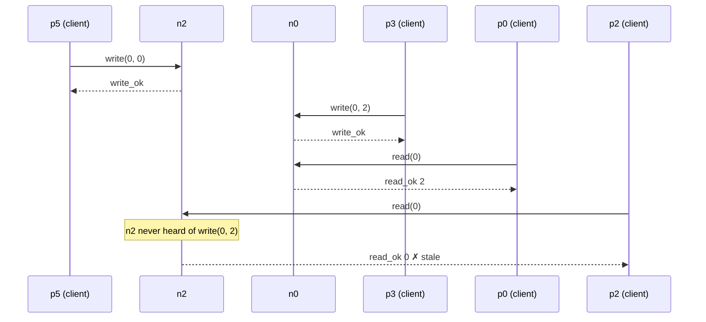

# Part 2 – One server

Code: `code/kv.py` (explained in `code.md` §2). All runs are listed in
`results/results.tsv`; the ones cited here are copied to `runs/`.

## 1. Single server, no faults

```
../kit/run.sh lin-kv code/kv.py --node-count 1
```

| run | verdict | ok | fail | info |
|---|---|---|---|---|
| `runs/p2-single` | **valid** | 152 | 60 | 0 |

The 60 `fail`s are not errors of the store: they are normal definite answers
— `cas` mismatches (error 22) and reads/cas on a key not yet written
(error 20). The checker drops them from the history (they had no effect).

## 2. Single server that crashes at 5 s

```
MS_CRASH="n0@5" ../kit/run.sh lin-kv code/kv.py --node-count 1
```

**Prediction:** valid, but after 5 s nothing completes.

| run | verdict | ok | fail | info | availability (`:ok-fraction`) |
|---|---|---|---|---|---|
| `runs/p2-single-crash` | **valid** | 33 | 25 | 15 | 0.45 |

What `../kit/timeline.py --history` shows (times from the first request):

```
 4.850  p0  invoke  read [0 nil] -> n0
 4.852  p0  ok      read [0 0]
 4.957  n0  crash
 4.961  p1  invoke  write [0 0] -> n0
 5.119  p0  invoke  read [0 nil] -> n0
 5.962  p1  info    write [0 0] :net-timeout      <- outcome unknown
 5.963  p3  invoke  cas [0 [2 0]] -> n0           <- p1 retired, p3 replaces it
 6.120  p0  fail    read [0 nil] :net-timeout     <- a read that times out is a fail
 6.963  p3  info    cas [0 [2 0]] :net-timeout
 6.963  p5  invoke  cas [0 [4 2]] -> n0
 ...
19.988  p29 info    cas [0 [2 0]] :net-timeout
```

Observations:

- From the crash on, every request times out after **1 s** (Maelstrom's
  client timeout). Not a single operation completes after 4.957 s.
- A timed-out **write or cas** becomes `info` and its process is retired
  (p1 → p3 → p5 → … → p29: 15 infos, one per second for the writer slot).
- A timed-out **read** becomes `fail`, not `info`: a read changes nothing,
  so treating it as "did not happen" is always safe. That is why p0, which
  happened to issue only reads, is never retired, and why the `fail` count
  also contains timeouts here.

**Why the client cannot know.** The client sent `write [0 0]` at 4.961 s and
got nothing. From its side this is the same as every case of Part 0, Q1:
lost request, crash before executing, crash after executing, lost reply, or
a slow server. (We know from the `crash` trace that n0 was already down, but
the client has no access to that; it only has its own timeout.) So it must
record `info`: the operation may or may not have happened. This is Part 0,
Q1 observed for real.

## 3. Correct? Available?

- **Correct: yes.** The checker reports valid. Every operation that
  completed is consistent with one sequential order, and an `info`
  operation can always be linearized (or left out) without contradiction.
  A store that answers nothing cannot give a wrong answer.
- **Available: no**, from 5 s on: 0 operations completed after the crash;
  `:ok-fraction` is 0.45 over the whole run.

Relation to the claim of Part 1: the run **supports** "linearizable even if
servers crash" (for f = 1 out of 1), and **contradicts** any claim that
requests are answered when the server crashes. With one server, the
service survives zero crashes as far as availability is concerned.

## 4. Three servers, no coordination

```
../kit/run.sh lin-kv code/kv.py
```

**Prediction:** invalid — each node is an independent store, so clients of
different nodes see different values.

| run | verdict | ok | fail | info |
|---|---|---|---|---|
| `runs/p2-independent` | **INVALID** | 152 | 58 | 0 |

`runs/p2-independent/independent/0/linear.svg` shows two reads and the
message **"can't read 0 from register 2"**. The full context from
`timeline.py --history --key 0` (only key 0 is used in this run):

```
 2.935  p5  invoke  write [0 0] -> n2
 2.937  n2  write   key=0 value=0          n2's copy: 0
 2.937  p5  ok      write [0 0]
 3.065  p3  invoke  write [0 2] -> n0
 3.066  n0  write   key=0 value=2          n0's copy: 2
 3.066  p3  ok      write [0 2]            <- write of 2 acknowledged
 3.104  p0  invoke  read [0 nil] -> n0
 3.106  p0  ok      read [0 2]             <- p0 reads 2 at n0
 3.128  p1  invoke  read [0 nil] -> n1
 3.130  p1  fail    read [0 nil] key does not exist   <- n1 never saw any write
 3.256  p2  invoke  read [0 nil] -> n2
 3.257  p2  ok      read [0 0]             <- p2 reads 0 at n2: STALE
```



**Explanation in our own words.** `write(0, 2)` was acknowledged at 3.066 s,
and p0 already read 2 at 3.106 s. p2's read started later (3.256 s), so in
any linearization it comes after both; the register must hold 2 (nothing
else was written in between), and the read must return 2. It returned 0,
because n2 has its own dictionary and nobody ever told it about the write
made at n0. No single order of the operations explains both reads: the
three servers are three different registers pretending to be one.

(The `fail` of p1 is a stale answer too — n1 says "key does not exist" for a
key written long before — but the checker cannot use it: a `fail` is
treated as "did not happen" and dropped from the history.)

This is the motivation for Part 3: the copies must coordinate.
