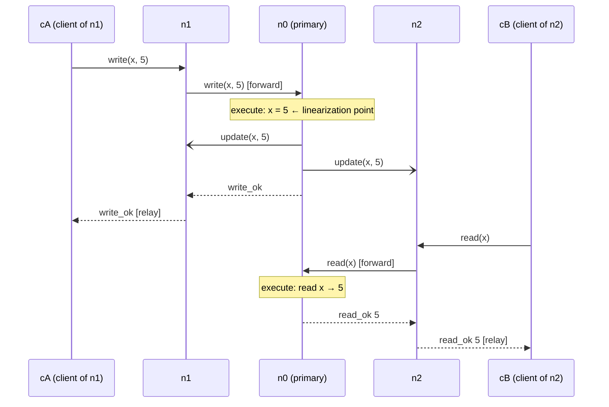

# Part 3 – Design: strategy D, "primary for everything"

> **D.** Every request is forwarded to n0, which executes it and sends the
> update to the others.

All three servers keep a full copy of the store and any server may receive
client requests.

## 1. Space-time diagram: a write, then a read from another client at another server

Client `cA` is attached to n1, client `cB` to n2. Time flows downwards.



The same picture as ASCII (for paper):

```
cA     n1          n0 (primary)        n2          cB
 |      |               |               |           |
 |--w-->|               |               |           |
 |      |---w(x,5)----->|               |           |
 |      |               X x=5           |           |
 |      |<--update------|---update----->|  (x=5, never read)
 |      |<--write_ok----|               |           |
 |<-ok--|               |               |           |
 |      |               |               |<--read----|
 |      |               |<--read(x)-----|           |
 |      |               X read x = 5    |           |
 |      |               |---read_ok 5-->|           |
 |      |               |               |--5------->|
```

Whatever the update to n2 does (arrives early, late, never), cB's read is
answered from n0's copy, which already holds 5. The read cannot be stale.

## 2. Details the strategy leaves open, and our decisions

| question | decision | why |
|---|---|---|
| What does a backup do with a client request? | Forward the request unchanged to n0 (`rpc`); when n0 answers, relay the answer to the client. | The strategy says *every* request goes to n0, reads included. |
| What does n0 do with a request from a client directly? | Execute it and reply, exactly as with a forwarded one. | n0 is also a server clients talk to. |
| What is sent to the backups? | The **new value** of the key (`update{key, value}`), after a successful `write` or `cas`. Nothing for reads or failed cas. | State transfer: backups do not need to re-evaluate a cas. |
| When does n0 send the update? | Right after executing, before replying; fire and forget. | The strategy does not mention waiting for acknowledgements. |
| What does a backup do when an update arrives? | Overwrite its copy of the key. No acknowledgement. | Simplest; there is nothing else to do with it under D. |
| How is `cas` handled? | Only at n0, like everything else; n0 checks and updates atomically in one handler. | Single point of execution. |
| What if n0 does not answer? | Nothing: no timeout, no error, no retry. The client's own timeout turns the request into `info` (write/cas) or `fail` (read). | Adding timeouts/failover is not part of D. |
| Who uses the backups' copies? | Nobody, under D. | They exist only so that a future failover *could* use them. |

Assumptions the design makes: n0 is fixed and known to all; n0 never fails
(nothing handles it); all handlers run on one thread per node (`ms.py`), so
n0 executes requests one at a time.

Suspected flaw (to be confirmed by the runs): **no fault tolerance for n0**.
D removes the inconsistency problem of the independent servers by having a
single copy that matters — and thereby keeps the single server's single
point of failure.

## 3. Predictions (before running)

| scenario | options | valid? | clients complete operations? | justification |
|---|---|---|---|---|
| No faults | (none) | **valid** | **yes**, all | every operation is executed by n0 on one copy, one at a time, between its invocation and its response — exactly like the single server. |
| Latency, more load | `--latency 50 --rate 50` | **valid** | **yes**, but slower | latency changes when things happen, not the single order at n0; a forwarded request takes 4 one-way messages (≈ 200 ms), still below the 1 s client timeout. |
| Primary crashes | `MS_CRASH="n0@5"` | **valid** | **no**, nobody after 5 s | clients of n0 get no answer, and n1/n2 forward to a silent n0 and never get an answer to relay; no answers means no wrong answers. |
| Another server crashes | `MS_CRASH="n1@5"` | **valid** | clients of **n1: no**; of n0 and n2: **yes** | n0 does not wait for n1, so only n1's own clients (⅓) lose service; n1's copy is never read, so missing updates do not matter. |
| Network partitions | `--nemesis partition` | **valid** | **partly**: clients of servers cut off from n0 time out during a partition; n0's clients always complete | forwarded requests (or their answers) are lost across the cut, which gives `info`, never a wrong value; we assume clients can always reach their own server. |

Results and comparison: `04-build-and-test.md`.
