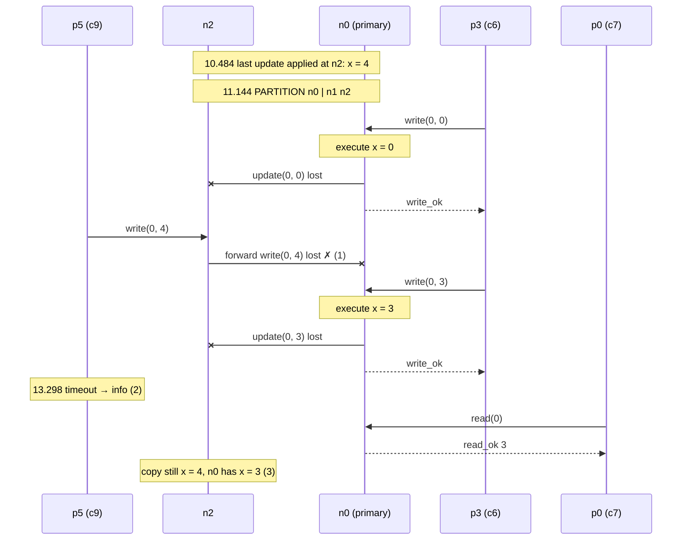
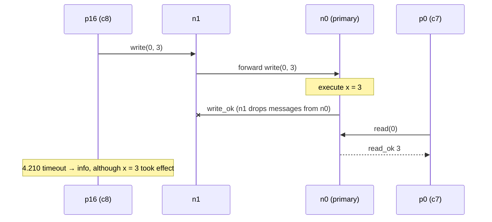

# Part 5 – Explain one execution

**All our strategy D runs were reported valid** (`04-build-and-test.md`).
So, as the guide asks, we explain (a) one interesting valid execution in
detail, (b) why its validity is not a coincidence, and (c) which scenario
could break the strategy.

The chosen run is the first partition run, `runs/p4-partition`
(`store/lin-kv/20261016T180341.995+0100`): **valid**, 124 ok, 55 fail,
8 info, `:ok-fraction` 0.66. It is the run where the most happens: a
partition, lost forwards, lost updates, indeterminate operations — and
still no anomaly.

## 1. Reconstruction

Sources: `./timeline.py --history` (client operations as `p<process>`,
plus our `trace` events), `messages.svg` (client ids), `timeline.html`.

**Who is who.** 6 client processes initially; worker *w* talks to node
`n(w mod 3)`. In this run: p0 and p3 → n0 (client ids c7, c6), p1 and p4
→ n1 (c10, c11), p2 and p5 → n2 (c8, c9). After an `info` a process is
replaced: p5 → p11 → p17 → p23 (n2), p4 → p10 → p16 → p22 (n1).

**Nemesis events.**

```
 0.003  nemesis  start-partition  [:isolated {"n2" #{}, "n1" #{}, "n0" #{}}]   <- isolates nobody
 4.751  nemesis  stop-partition   :network-healed
11.144  nemesis  start-partition  [:isolated {"n0" #{"n2" "n1"}, "n2" #{"n0"}, "n1" #{"n0"}}]
                                   (lasts until the end of the test)
```

The first "partition" is empty (each node isolated from the empty set), so
it changes nothing. The second cuts **n0 off from both backups**.

**Before the cut** (≤ 11.144 s), everything works as designed, e.g.:

```
10.817  p2   invoke   read [0 nil] -> n2
10.819  n2   forward  key=0 op="read" client="c8"
10.819  n0   execute  key=0 op="read" value=4 src="n2"
10.820  n2   relay    key=0 op="read" client="c8" result="read_ok"
10.820  p2   ok       read [0 4]
```

and the last update both backups applied is

```
10.484  n1   apply    key=0 value=4
10.484  n2   apply    key=0 value=4
```

**After the cut:**

```
11.144  nemesis  start-partition   n0 | n1 n2
11.172  p2   invoke   read [0 nil] -> n2
11.173  n2   forward  key=0 op="read" client="c8"        <- never reaches n0
12.097  p3   invoke   write [0 0] -> n0
12.099  n0   execute  key=0 op="write" value=0 src="c6"   n0: 0
12.099  n0   propagate key=0 value=0                      <- no "apply" anywhere
12.100  p3   ok       write [0 0]
12.172  p2   fail     read [0 nil] :net-timeout           <- timed-out read = fail
12.197  p0   ok       read [0 0]                          (n0's client)
12.298  p5   invoke   write [0 4] -> n2
12.299  n2   forward  key=0 op="write" client="c9"        <- never reaches n0
12.437  p3   invoke   write [0 4] -> n0      ... ok        n0: 4
13.009  p3   invoke   write [0 4] -> n0      ... ok        n0: 4
13.275  p3   invoke   write [0 3] -> n0
13.277  n0   execute  key=0 op="write" value=3 src="c6"   n0: 3
13.277  p3   ok       write [0 3]
13.298  p5   info     write [0 4] :net-timeout            <- outcome unknown to the client
13.565  p0   ok       read [0 3]
...
19.973  n0   propagate key=0 value=3                      n0 ends with 3
```

Counted over the whole partition (11.144 s – end):

| clients of | ok | fail | info |
|---|---|---|---|
| n0 | **49** | 19 (cas mismatches, missing key) | 0 |
| n1 | **0** | 2 (timed-out reads) | 4 |
| n2 | **0** | 5 (timed-out reads) | 4 |

and **0** `execute` events at n0 with `src` = n1 or n2: not one forwarded
request crossed the partition. The clients themselves were never cut off
from their own servers (n2 kept logging `forward` for c8, c9): Maelstrom's
partitions only cut server-to-server links.

## 2. Space-time diagram



ASCII version (time downwards):

```
 p5(c9)        n2                 n0 (primary)          p3(c6)     p0(c7)
   |            | x=4 (10.484)      |                     |          |
 ==|============|=== PARTITION =====|== 11.144 ===========|==========|==
   |            |                   |<----write(0,0)------|          |
   |            |     update(0,0)   X x=0                 |          |
   |            |   <- - - -x  lost |-----write_ok------->|          |
   |--write(0,4)>|                   |                     |          |
   |            |--forward--x lost  |    (1) never arrives|          |
   |            |                   |<----write(0,3)------|          |
   |            |     update(0,3)   X x=3                 |          |
   |            |   <- - - -x  lost |-----write_ok------->|          |
   |  1 s, no answer                |                     |          |
 (2) info       |                   |<-------read(0)-----------------|
   |            |                   |--------read_ok 3-------------->|
   |       (3) x=4 at n2            x=3 at n0
```

**Marked points:**

1. **Where things go wrong (for availability):** the forwarded request is
   dropped by the partition. n2 has no way to answer: under D it may not
   answer from its own copy, and it has no timeout.
2. **Indeterminacy:** p5 records `info`. *We* know (from the trace) that
   the write was never executed; p5 cannot know: from its side this is
   identical to "executed, reply lost". The checker treats it the same way:
   it may linearize the write somewhere after 12.298 s or leave it out. Here
   leaving it out is consistent with all reads (p0 keeps reading 3).
3. **Hidden divergence:** at the end n2's copy says 4 and n0's says 3. The
   copies are inconsistent, but **no client can observe it** because, under
   D, nobody ever reads a backup.

### A second excerpt: an `info` write that *did* happen

In the run above every `info` was a request that never reached n0. The
second partition run, `runs/p4-partition-2`
(`store/lin-kv/20261016T180412.639+0100`, valid, 117/72/10), shows the
other half of Part 0, Q1. Its first partition is **asymmetric**:
`{"n1" #{"n0"}, "n0" #{"n2"}, "n2" #{"n1"}}` — n1 drops messages from n0,
n0 drops messages from n2, n2 drops messages from n1. So n1's forwards
*reach* n0, but n0's replies to n1 are lost:

```
3.210  p16  invoke   write [0 3] -> n1
3.211  n1   forward  key=0 op="write" client="c8"
3.212  n0   execute  key=0 op="write" value=3 src="n1"   <- executed!
3.212  n0   propagate key=0 value=3                        (write_ok to n1 is dropped)
3.291  p0   invoke   read [0 nil] -> n0
3.293  p0   ok       read [0 3]                            <- another client sees it
...
4.210  p16  info     write [0 3] :net-timeout             <- its own client never learns
```

p0 read 3 at 3.293 s, and p16's is the only write of 3 in progress at that
time. So the checker **must** linearize p16's `info` write between 3.210 s
and 3.291 s — and it can, so the run is valid. The client that issued the
write records "unknown", while a different client has already observed its
effect: exactly the "executed, reply lost" case of Part 0, Q1.



## 3. Does this execution violate our specification?

**No.** Every `ok` operation was executed by n0 on one copy, one at a time;
the order of the `execute` events is a valid linearization (each lies
between its invocation and its response, and each read returns the latest
value written before it in that order). The 8 `info` writes/cas are
allowed by our specification ("an operation whose client got no answer may
or may not have taken effect"). Our specification and the checker agree
here: both use linearizability, and both treat an unanswered operation as
indeterminate.

What the execution *does* violate is the **availability** part of our
first claim ("every request is eventually answered"): two thirds of the
clients got no answer for the last ~9 s.

## 4. Why "always valid" is not a coincidence

Every D run is valid because of a structural property, not luck:

- **One copy is authoritative and it alone answers.** Every response a
  client receives was produced by n0 from n0's store.
- **n0 executes operations one at a time** (single-threaded `ms.py`
  handlers), each in a single step, between receiving the request and
  sending the reply. That instant is a linearization point inside the
  operation's interval.
- **Faults can only remove answers, never change them.** Crashes and
  partitions drop messages; dropped requests or replies become `info`/`fail`,
  which never contradict linearizability. Latency only moves the points in
  time.

So for crash-stop faults, message loss, delays, reordering and partitions,
the argument holds whatever the timing. Repeating with more load
(`--latency 100 --rate 100`) did not change it (`04-build-and-test.md`).

## 5. Which scenario could break D?

None of the five scenarios can break its *safety*; they can only break
availability (n0 crash: nothing completes; partition: the side without n0
gets nothing). What *would* break correctness:

- **Any failover.** As soon as a backup is allowed to answer (or take over)
  when n0 is unreachable, the divergence of point (3) becomes visible: n2
  would answer `read → 4` after `write(0, 3)` was acknowledged → stale read,
  invalid. Worse, n0 may still be alive on the other side (split brain).
- **n0 losing its memory on restart** (crash-recover with amnesia): it
  would come back with an empty or old store and answer reads with values
  older than acknowledged writes. `ms.py`'s pauses keep memory, so we
  cannot inject this directly.
- **Duplicated messages** (not produced by Maelstrom): a delayed duplicate
  of an old forwarded `write` could be executed again after newer writes.

## 6. Revised claim (with evidence)

> *Under* the assumptions of Part 1 (3 servers; crash-stop failures;
> messages may be delayed, reordered or lost through partitions, but not
> duplicated or corrupted; asynchronous timing), *if at most* **2 servers
> other than n0** *fail by* crashing or being partitioned from n0, *the
> service guarantees* that every operation is **linearizable** and that
> the clients of **n0 and of every server still connected to n0** get
> answers. **Linearizability holds for any number of failures, including
> n0's**, but if n0 crashes no client gets an answer, and during a
> partition clients of servers cut off from n0 get none.
>
> *Evidence:* 19 Maelstrom `lin-kv` runs of `code/d.py`, all valid: no
> faults ×3, `--latency 50 --rate 50` ×3, `--latency 100 --rate 100` ×3,
> `MS_CRASH=n0@5` ×3 (0 ok after 5 s), `MS_CRASH=n1@5` ×3 (only n1's
> clients stop), `--nemesis partition` ×3 (only clients of servers cut off
> from n0 stop), `MS_CRASH=n0@5-12` ×1 (service resumes when n0 returns).
> The argument of §4 explains why this holds independently of timing.
>
> *Not covered:* availability when n0 is down (there is no failover: the
> service tolerates **0** crashes of n0); n0 restarting without its memory;
> duplicated messages; more than 3 servers or runs longer than 20 s;
> durability (the backups' copies may be stale and divergent, so they do
> not protect acknowledged writes against the loss of n0).

## Revisiting Part 0

- **Q1** (outcomes of a write when the server crashes): observed exactly,
  as `info` operations, both in Part 2 and here — and here the traces show
  both kinds: `info` writes that were *never executed* (forward lost) and
  one that *was* executed and even read by another client (reply lost).
  Their clients could not tell them apart.
- **Q2** ("works correctly if…"): the checker's notion is linearizability,
  matching our Part 1 specification; correctness does not include
  availability.
- **Q3** (three copies): with D, *none* of the single-server problems went
  away — n0 is still a single point of failure — and the new problem
  (diverging copies) appeared, just hidden. With A/B/C the copies are
  visible, and the new problems become anomalies.
